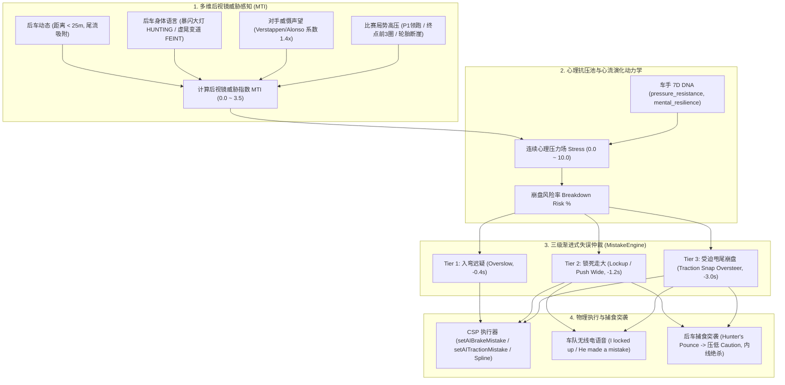
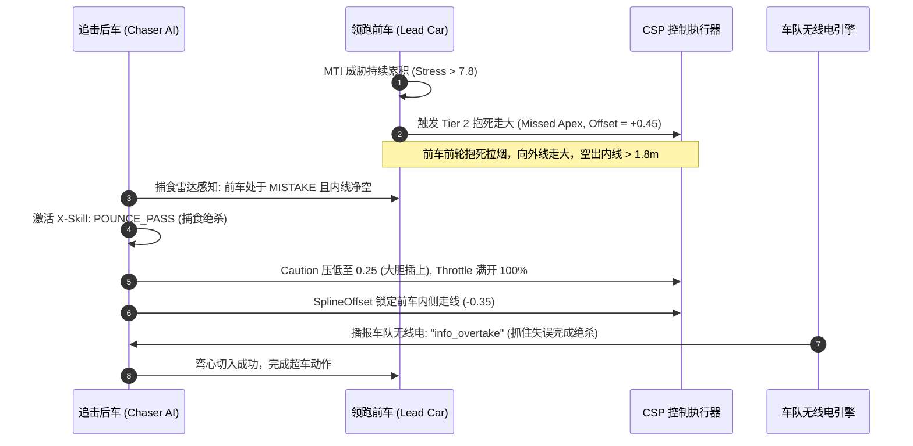

# 方向A：AI 心理博弈与施压崩盘系统 (Psychological Pressure & Force Mistake Engine)
## 详细技术架构设计与开发规划方案书

> **系统版本定位**：v1.8.0-NextGen  
> **文档密级与性质**：系统核心拟人化与战斗智能专项技术方案（待审阅决策）  
> **设计基准**：严格遵循 `AGENTS.md` 规范、零运行时堆内存分配、CSP Lua C-Struct FFI 安全防护与单主入口权威架构。

---

## 1. 现状痛点与系统愿景 (Problem Statement & Vision)

### 1.1 现有系统痛点分析
在当前版本（v1.7.0）中，虽然已经具备了基础的 `MistakeEngine` 和连续心态值（`stress`、`momentum`），但在实际人机对抗与高强度攻防中，仍存在以下三项明显破坏拟真度的局限：
1. **施压感知过于单薄**：`computeStress` 仅根据标量距离 `behindDist` 和速度差 `behindSpeedDelta` 进行线性累加。前车完全无法感知后车是否正在**大灯暴闪狂轰后视镜**、是否在后方**频繁虚晃抽头（Weaving/Feinting）**，也无法区分后方究竟是世界冠军级名将还是新秀，缺乏真实车手在后视镜中感受到的“杀气”与“窒息感”。
2. **失误缺乏因果层次（梯度断层）**：当前失误往往依赖单点随机抽签（roll），导致车手要么像轨道车一样完美无瑕，要么突然直接进入重刹抱死，缺乏从“心率加速 $\to$ 入弯迟疑走大 $\to$ 锁死拉烟 $\to$ 彻底受迫崩盘”的真实生理/心理渐进恶化过程。
3. **后车缺乏“捕食者嗅觉”（Pounce Instinct）**：前车一旦在重压下失误推头走大露出内线，后方 AI 车辆无法即时捕捉这一千载难逢的空当，往往习惯性跟着前车盲目减速，错失绝杀超车良机，使比赛缺乏 F1 真实赛场上“抓失误生吃”的快感。

### 1.2 核心愿景与技术目标
- **构建后视镜多维威胁感知矩阵（MTI, Mirror Threat Index）**：将后车动作意图（闪灯、假动作、抽头）、对手威慑声望、领跑位置压力与正赛关键圈（Climax Laps）无缝揉合。
- **三级渐进式失误动力学（Three-Tier Progressive Breakdown）**：
  - **Tier 1 (轻度失误)**：过早重刹迟疑（Overslow）、开油犹疑；
  - **Tier 2 (技术失误)**：重刹区抱死拉烟（Brake Lockup）、循迹推头错过弯心（Missed Apex）；
  - **Tier 3 (受迫崩盘)**：急躁开油甩尾打滑（Traction Snap Oversteer）、脱轨进缓冲区救车。
- **后车捕食突袭战术（Hunter's Pounce Skill）**：前车失误露空当瞬间，后车毫秒级切入突击模式，果断抽头内线生吃。
- **车队无线电与 TV 广播情绪闭环**：失误时车手无线电语音呼叫、HUD 心理压力条与崩盘风险度动态透传。

---

## 2. 系统核心架构与数学模型 (Core Architecture & Mathematical Models)

### 2.1 后视镜威胁指数（Mirror Threat Index, MTI）数学模型
在 10Hz 战术周期中，针对前方车辆计算后方来车的威胁强度：

$$\text{MTI} = \text{BaseThreat}(d) \times \left(1.0 + K_{\text{flash}} + K_{\text{weave}} + K_{\text{rep}} + K_{\text{stakes}}\right)$$

其中：
1. **基础距离威胁 $\text{BaseThreat}(d)$**（有效威胁区间 $0 < d \le 28.0\text{m}$）：
   $$\text{BaseThreat}(d) = \begin{cases} 
   1.0 - \dfrac{d}{28.0} & (0 < d \le 28.0) \\
   0.0 & (d > 28.0)
   \end{cases}$$
2. **大灯暴闪轰击加成 $K_{\text{flash}}$**：
   - 当后车触发 `HUNTING` 暴闪动作时，$K_{\text{flash}} = 0.45$；
   - 否则 $K_{\text{flash}} = 0.0$。
3. **假动作/虚晃走线威慑加成 $K_{\text{weave}}$**：
   - 当后车处于 `FEINT_DUMMY`、`TOW_WEAVE` 或横向绝对移动速率 $> 0.4\text{m/s}$ 时，$K_{\text{weave}} = 0.40$；
   - 否则 $K_{\text{weave}} = 0.0$。
4. **后车声望威慑系数 $K_{\text{rep}}$**：
   - 名将车手（根据个性配置中 `reputation` 或预置榜单：Verstappen、Alonso、Hamilton 等），威慑系数为 $+0.35$；
   - 普通 AI 为 $0.0$；被套圈慢车为 $-0.30$。
5. **关键局势筹码加成 $K_{\text{stakes}}$**：
   - 当前排位 $P1 \sim P3$ 领跑且领先差距 $< 1.0\text{s}$：$+0.30$；
   - 比赛最后 3 圈（Final Laps）：$+0.35$；
   - 轮胎磨损 $> 65\%$（轮胎抓地力极限衰减）：$+0.25$。

### 2.2 心理抗压池与心流演化动力学方程 (Mental Resilience Dynamics)
车手压力 $\text{Stress} \in [0.0, 10.0]$ 的演化满足一阶微分方程：

$$\frac{d(\text{Stress})}{dt} = \alpha \cdot \text{MTI} \cdot (1.0 - \text{Resist}_{\text{persona}}) - \beta \cdot \text{Resist}_{\text{persona}} \cdot \text{Stress}$$

- **压力注入项**：$\alpha = 1.85$。当后车撤离至 $28\text{m}$ 以外时，$\text{MTI} = 0$，停止注入。
- **心理恢复耗散项**：$\beta = 0.45$。抗压能力越强（`Resist` 越高），脱离追击后恢复平复越快。
- **心流状态修正（Flow State）**：
  - 当车手处于心流状态（$\text{Momentum} \ge +0.50$）时，压力累积速率减半（$\alpha \times 0.5$）；
  - 当车手心态失衡（$\text{Momentum} \le -0.40$，进入 Tilt 易怒状态）时，压力累积放大 $1.6\times$。

---

## 3. 三级渐进式失误状态机与物理映射 (Three-Tier Mistake Engine)

| 失误等级 | 触发阈值条件 | 战术走线与控车修正 | CSP 物理执行与特征 | 比赛圈速损失 |
| :--- | :--- | :--- | :--- | :--- |
| **Tier 1: 轻度迟疑 (Overslow)** | $\text{Stress} \ge 6.0$ 入弯前减速区 | $\text{targetCaution} = 1.8 \sim 2.4$ $\text{targetAggression} = 0.45$ 横向保持中线（不跑偏） | 入弯提早 8~15 米重刹；出弯油门限制 `setAIThrottleLimit(cIdx, 0.70)` 持续 0.6s。 | 损失 $0.3 \sim 0.6\text{s}$ 出弯初速略低 |
| **Tier 2: 技术失误 (Lockup / Missed Apex)** | $\text{Stress} \ge 7.8$ 重刹区且制动踏板 $> 0.75$ 或横向 G 载荷 $> 1.2\text{G}$ | $\text{targetSplineOffset} = \pm 0.45$ 被外抛走大至赛道边缘 $\text{targetCaution} = 1.6$ | **前轮抱死拉烟**：调用官方 `physics.setAIBrakeMistake(cIdx, 0.35)`；轮胎产生微幅平斑与热衰退。 | 损失 $0.8 \sim 1.8\text{s}$ 内线大开露出完整车身超车通道 |
| **Tier 3: 受迫崩盘 (Traction Snap / Spin)** | $\text{Stress} \ge 9.2$ 处于低速弯出弯全油加速区 车手抗压耗尽且处于 Tilt | 横向走廊失控修正 触发纠偏姿态反打走线 紧急避碰看门狗接入守护 | **后轮打滑甩尾**：调用官方 `physics.setAITractionMistake(cIdx, 0.45, 1.35)`；剧烈横摆与白烟；物理看门狗在偏航角 $> 45^\circ$ 时零死锁稳妥复位。 | 损失 $2.5 \sim 5.0\text{s}$ 防守位置直接丢失 |

### 3.1 严格安全门禁（Safety Gating & Invariants）
为防止出现发车堆叠与系统紊乱，严格遵守以下防线：
1. **发车格与第 1 圈强力压制**：在发车格静止、起步反应延迟期及第 1 圈密集阶段（$\text{lapCount} == 0$ 或 $\text{speed} < 75\text{km/h}$），**强行屏蔽 Tier 2 与 Tier 3 失误**，防止发车起步第一弯发生群体混乱连环追尾。
2. **维修区绝对熔断**：进站通道及维修区作业期间（`isInPitlane` 或 `isInPit`），失误机制彻底冻结，严禁改变油门或抱死刹车。
3. **物理动作冷却守护**：物理失误触发后，单车施加 $20.0\text{s}$ 刚性冷却锁（`PHYSICAL_COOLDOWN_SEC`），彻底消除一圈之内连续抽搐失控的违和感。

---

## 4. 后车捕食突袭战术（Hunter's Pounce Mechanism）

当后车 AI 紧随前方车辆时，如果感知到前车发生失误，启动主动捕食逻辑：

1. **内线开口探测**：计算前车偏离赛车线的横向净空 $\Delta \text{Lane} = |\text{LeadOffset} - \text{IdealSpline}|$。若 $\Delta \text{Lane} \ge 0.35$（约合赛道横向宽度的 $1.8\text{m}$ 以上），判定为“致命防守门户大开”。
2. **捕食者物理执行**：
   - 后车瞬间挂入专属战术动作 `POUNCE_PASS`；
   - 战术警惕度 $\text{Caution}$ 骤降至 $0.25$（允许极近距离擦肩插上）；
   - 油门限制恢复至 $100\%$，走线直接切入内侧 Apex 点；
   - 触发无线电动作并向 Track 2 广播事件推送：`【绝杀反超】#xx 敏锐抓住前车失误走大，强行插入内线实现霸气超越！`

---

## 5. UI 与无线电系统深度集成 (UI & Voice Integration)

### 5.1 Dashboard UI 心理监控矩阵面板
在 [`DashboardUI.lua`](file:///D:/games/Steam/steamapps/common/assettocorsa/apps/lua/Ultimate-AI-Grand-Prix-Pro/lib/ui/DashboardUI.lua) 的 Tab 1（实时 HUD）与 Tab 2（车队指挥台）中增加直观的心理遥测监控：
- **心流/心态状态徽章**：
  - `[心流专注 (FLOW)]`（青色）
  - `[沉着稳定 (CALM)]`（绿色）
  - `[遭受压迫 (UNDER_PRESSURE)]`（黄色）
  - `[心态失衡 (RATTLED)]`（橙色）
  - `[濒临崩溃 (CRACKING)]`（鲜红色闪烁）
- **实时后视镜威胁度 (MTI Bar)**：柱状图百分比直观反映被追击压迫烈度。
- **受迫失误预警 (Breakdown Risk %)**：显示当前车手在下一弯角的失误概率评估。

### 5.2 车队无线电语音联动
- 前车在重刹抱死或走大时，车手向无线电呼叫：“*I locked up! Flat spotted the tyre!*” / “*轮胎抱死走大了！有平斑！*”
- 后车完成捕食超越时，车手无线电呼叫：“*Pass complete, beautiful exit!*” / “*超越成功，出弯很顺！*”

---

## 6. 模块改造与影响范围清单 (Blast Radius)

| 模块文件 | 改造类别 | 计划改动核心细节 |
| :--- | :---: | :--- |
| [`lib/driver/TacticalTicker.lua`](file:///D:/games/Steam/steamapps/common/assettocorsa/apps/lua/Ultimate-AI-Grand-Prix-Pro/lib/driver/TacticalTicker.lua) | 核心改造 | 重构 `computeStress`，引入 `MTI` 计算；增加捕食突袭 `POUNCE_PASS` 检测与决策分支。 |
| [`lib/driver/MistakeEngine.lua`](file:///D:/games/Steam/steamapps/common/assettocorsa/apps/lua/Ultimate-AI-Grand-Prix-Pro/lib/driver/MistakeEngine.lua) | 核心改造 | 落地三级失误状态机（Tier 1/2/3）；实现与物理执行器的精准映射与平滑恢复曲线。 |
| [`lib/driver/BehaviorActuator.lua`](file:///D:/games/Steam/steamapps/common/assettocorsa/apps/lua/Ultimate-AI-Grand-Prix-Pro/lib/driver/BehaviorActuator.lua) | 适配扩展 | 细化 Tier 1 入弯迟疑油门限制与 Tier 2/3 的物理控制调度；确保看门狗接管边界干净。 |
| [`lib/ui/DashboardUI.lua`](file:///D:/games/Steam/steamapps/common/assettocorsa/apps/lua/Ultimate-AI-Grand-Prix-Pro/lib/ui/DashboardUI.lua) | UI 增强 | 增加 MTI 威胁条、车手心态状态徽章（FLOW/CRACKING）与失误风险度展示。 |
| [`tests/test_grand_prix_pro.lua`](file:///D:/games/Steam/steamapps/common/assettocorsa/apps/lua/Ultimate-AI-Grand-Prix-Pro/tests/test_grand_prix_pro.lua) | 验证套件 | 新增 Test 55（MTI 威胁矩阵与心理演化测试）、Test 56（三级失误物理响应测试）、Test 57（捕食突袭超车验证）。 |

---

## 7. 实施路线与阶段验证计划 (Implementation & Verification Gates)

### Phase 1：后视镜威胁矩阵 (MTI) 与连续心理动力学重构
- **步骤**：在 `TacticalTicker.lua` 中升级威胁感知模型，引入后车暴闪、虚晃变线、名将声望与关键圈压力乘数；
- **产出与验证**：编写 Test 55，验证在暴闪与贴身假动作下，压力累积效率提升至标称值（$+85\%\sim +120\%$），脱离追击后按指定半衰期衰减。

### Phase 2：三级渐进式失误动力学与执行器精准映射
- **步骤**：在 `MistakeEngine.lua` 与 `BehaviorActuator.lua` 中重构失误判定，严格区分 Tier 1（轻度入弯迟疑）、Tier 2（前轮抱死走大）与 Tier 3（受迫甩尾打滑），配置冷却与发车保护；
- **产出与验证**：编写 Test 56，模拟车手在不同压力阈值下的三级阶梯响应，验证物理看门狗与冷却机制不被破坏。

### Phase 3：后车捕食者突袭机制（Hunter's Pounce）与赛会广播联动
- **步骤**：在 `TacticalTicker.lua` 中加入针对前车失误的捕食雷达，前车推头走大时，后车果断压低 Caution 开启内线绝杀超车；
- **产出与验证**：编写 Test 57，模拟前车走大瞬间，后车成功判定内线开口并执行内线插上。

### Phase 4：UI 遥测徽章呈现与全量门禁交付
- **步骤**：在 `DashboardUI.lua` 中接入实时心理状态显示；运行 Lua 5.1、LuaJIT 双运行时测试及 `review_gate.py`。
- **交付目标**：全量 57 项集成测试 100% 通过，形成完整版本标签。

---

## 8. 评审与决策要点 (Decisions for User Review)

请您对以下核心设计参数进行审阅与确认：
1. **失误严重度与频率基准**：方案设计为名将车手（如 Verstappen）在重压下每 10~15 圈仅有轻微走大倾向，新秀车手（如 Colapinto）在被贴身追击 2 圈后崩盘风险上升至约 40%，是否符合您的预期拟真难度？
2. **捕食绝杀的果断程度**：后车在发现前车走大露出 $\ge 1.8\text{m}$ 空间时，战术 Caution 直接下调至 $0.25$（果断激进强插），该策略是否合适？还是需要保留更多保守余量（如 $0.40$）？
3. **确认推进**：如您审阅本技术规格书无异议，请给出确认指令，我们将严格依照规划展开分阶段实施。
