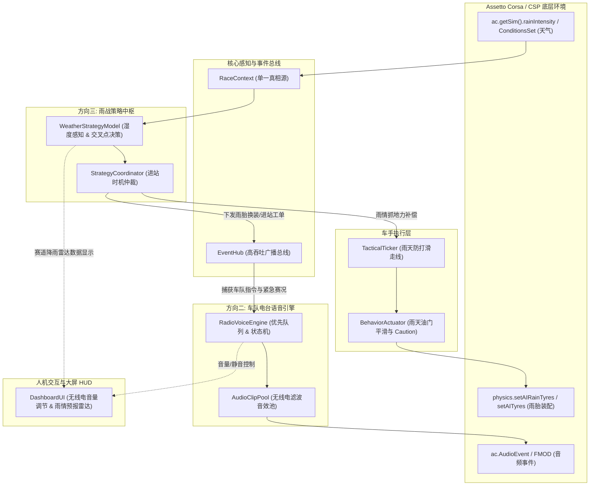
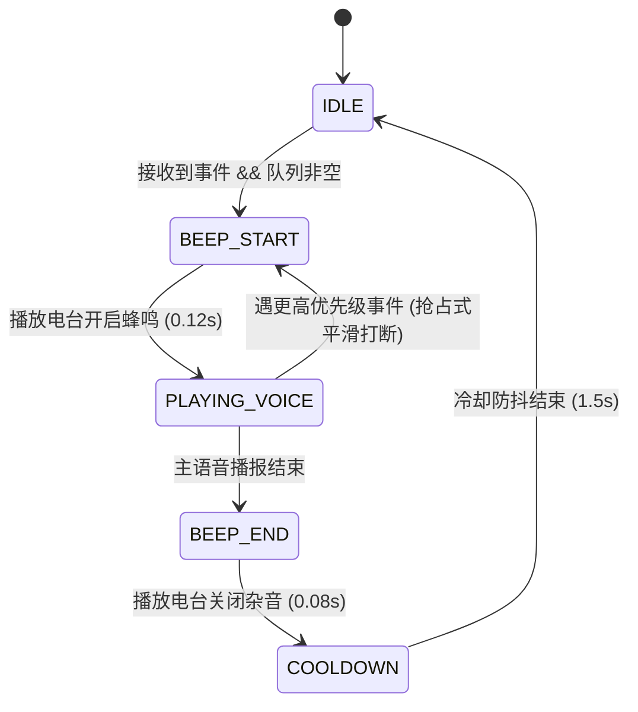
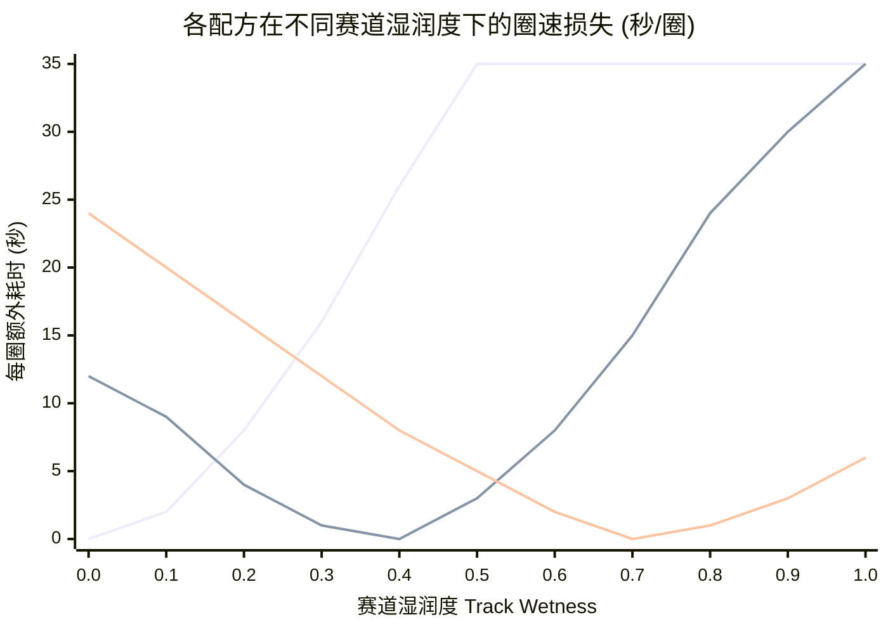

# Ultimate AI Grand Prix Pro: 方向二与方向三技术架构与设计规范

> **定位**：针对项目在完成 v1.6.0 证据门禁整改后的两大核心演进方向 —— **车队电台语音引擎**（方向二）与 **动态天气与雨战策略中枢**（方向三）进行系统化设计，供决策评审。

---

## 目录
1. [系统总体演进蓝图](#1-系统总体演进蓝图)
2. [方向二：沉浸式车队电台语音引擎 (Team Radio Audio Engine)](#2-方向二沉浸式车队电台语音引擎)
   - 2.1 业务诉求与体验目标
   - 2.2 技术选型与双轨架构对比
   - 2.3 状态机与优先队列调度机制
   - 2.4 音频资源库规范与无线电混响滤波
   - 2.5 接口契约与 EventHub 消费拓扑
3. [方向三：动态天气与雨战策略中枢 (Dynamic Weather & Wet Tyre Strategy)](#3-方向三动态天气与雨战策略中枢)
   - 3.1 业务诉求与拟人化博弈场景
   - 3.2 CSP 天气感知与地表湿度量化
   - 3.3 交叉窗口（Crossover Point）动态进站决策模型
   - 3.4 雨战自适应驾驶行为与物理补偿
   - 3.5 轮胎装配与底层物理注入闭环
4. [工程约束与质量基线 (Zero-Allocation & FFI Safety)](#4-工程约束与质量基线)
5. [分阶段交付计划与待决决策项](#5-分阶段交付计划与待决决策项)

---

## 1. 系统总体演进蓝图

两大特性的加入在保持单向依赖契约的前提下，进一步补全了拟人化 AI 决策链与多感官交互层：



---

## 2. 方向二：沉浸式车队电台语音引擎

### 2.1 业务诉求与体验目标
当前车队指令（PUSH、SAVE、BOX、ATTACK、DEFEND）以及赛场突发状况（安全车、黄旗、进站 Undercut）仅通过屏幕下方的文字和 Track 1 / Track 2 双轨广播呈现。在激烈的车阵竞速中，玩家很难时刻低头阅读文字，极度需要**真实 F1 车队无线电（Team Radio）** 的听觉提示。

### 2.2 技术选型与双轨架构对比

| 评估维度 | 方案 A：内置 F1 无线电音频切片库 (推荐) | 方案 B：外部伴随 TTS 进程 (Python SAPI/Edge-TTS) |
| :--- | :--- | :--- |
| **执行机制** | 纯 CSP 原生 `ac.AudioEvent.fromFile` 播放预录制高质量音频切片 | 后台 Python 进程监听共享内存，调用语音合成库实时生成音频 |
| **外部依赖** | **零依赖**。纯 Lua + CSP 本地资源 | 需要额外运行外部 Python 脚本或后台守护进程 |
| **播放延迟** | **< 5ms（即时触发）** | 300ms ~ 800ms（进程间通信与 TTS 推理耗时） |
| **听感质感** | **真实 F1 围场质感**（自带无线电高通/带通失真与尾部静电杂音） | 机械电子合成音，语调生硬，拟真感较弱 |
| **动态扩展性** | 覆盖预设的标准无线电场景（30+ 常用短语） | 支持读出任意车手名字与动态秒数差距 |
| **系统稳定性** | **100% 确定性**，无进程崩溃风险 | 依赖外部进程存活，存在断联与异常隐患 |

> [!TIP]
> **架构决策**：**采用“方案 A 作为核心基座 + 方案 B 预留接口”的双模设计**。  
> 默认情况下，系统采用 100% 零依赖的原生高质量无线电音频切片库，开箱即用；同时在 `TelemetryBridge.lua` 保留无线电事件广播通道，供进阶极客用户自由挂载外部 TTS 语音伴随程序。

### 2.3 状态机与优先队列调度机制

电台语音绝不可重叠播报（避免破音刺耳），必须建立严格的**单通道时间片状态机**与**三级优先级队列**：



- **三级优先级排序**：
  1. **`P0_EMERGENCY`（紧急）**：安全车出动、赛车严重爆胎/故障、前方重大撞车黄旗（可平滑打断 P2）。
  2. **`P1_COMMAND`（车队指令）**：玩家主动下发的 `BOX_THIS_LAP`、`PUSH`、`SAVE`、`ATTACK`、`DEFEND`，以及 Undercut 窗口触发。
  3. **`P2_TACTICAL`（战术播报）**：关键超越成功致意、最快圈速刷新、蓝旗让车提示。
- **智能防抖过滤**：同类型语音设置 15.0 秒去重冷却期，防止重复刷屏打扰驾驶。

### 2.4 音频资源库规范
资源文件存放在插件根目录的 `audio/radio/` 下，统一采用 44.1kHz、16-bit 单声道 OGG 格式（体积极小、加载秒开），内部施加 300Hz~3400Hz 的电台带通滤波与白噪声底纹：
- **启闭控制音**：`beep_open.ogg`, `beep_close.ogg`, `static_burst.ogg`
- **车队指令类**：
  - `cmd_box_this_lap.ogg` (*"Box this lap, confirm, box now."*)
  - `cmd_push.ogg` (*"Push now, give it everything."*)
  - `cmd_save.ogg` (*"Mode save, manage the tyres and lift and coast."*)
  - `cmd_attack.ogg` (*"Attack mode enabled, hunt the car ahead."*)
  - `cmd_defend.ogg` (*"Defend track position, hold the inside line."*)
- **战术情势类**：
  - `info_undercut.ogg` (*"Undercut window is open, we need green sectors."*)
  - `info_safety_car.ogg` (*"Safety Car deployed, delta positive, hold position."*)
  - `info_yellow_flag.ogg` (*"Yellow flag ahead, no overtaking."*)
  - `info_blue_flag.ogg` (*"Blue flag, let the leader pass safely."*)

---

## 3. 方向三：动态天气与雨战策略中枢

### 3.1 业务诉求与拟人化博弈场景
在真实 F1/GT 赛事中，雨战是策略博弈与车手分化的核心看点。当前 AI 赛车仅具备干地模型，当环境突降暴雨时，若 AI 仍旧使用干胎不仅极易打滑失控，而且破坏游戏拟真度。系统需要建立**降雨强度感知 $\to$ 交叉窗口演算 $\to$ 自动进站换雨胎 $\to$ 雨天控制补偿** 的完整闭环。

### 3.2 CSP 天气感知与地表湿度量化
通过 CSP 官方环境接口实现高鲁棒性感知（防御 LuaJIT FFI 越界）：
- **核心数据采样**：
  ```lua
  local rainIntensity = RaceContext.safeSimGet(sim, "rainIntensity") or 0.0 -- 0.0 ~ 1.0
  local roadGrip = RaceContext.safeSimGet(sim, "roadGrip") or 1.0          -- 0.0 ~ 1.0
  ```
- **赛道地表动态积水率模型（Track Wetness Model）**：
  地表水膜厚度具备自然累积与排干滞后性。建立 1Hz 纯标量微分模型：
  $$\text{Wetness}_{t} = \text{Wetness}_{t-1} + (\text{rainIntensity} \times k_{\text{accum}} - k_{\text{drain}}) \cdot \Delta t$$
  - 当雨停时，由于赛车碾压排干与自然蒸发，赛道逐渐出现“干燥行车线”。

### 3.3 交叉窗口（Crossover Point）动态进站决策模型

针对不同地表湿润度（Wetness $\in [0, 1]$），建立三种核心轮胎形态的性能衰减包络：



- **交叉点（Crossover Point）自动换胎规则**：
  1. **干地 $\to$ 半雨（Slicks to Inters）**：
     - 当 $\text{Wetness} \ge 0.22$ 且持续下雨时，半雨胎圈速超越干胎。
     - 若剩余赛程圈数 $\times \Delta T_{\text{lap}} > 22.0\text{s}$（一次停站损耗），**立即触发进站更换半雨胎**。
  2. **半雨 $\to$ 全雨（Inters to Full Wets）**：
     - 当 $\text{Wetness} \ge 0.60$（暴雨积水，水漂风险极高），半雨胎排水槽饱和。
     - **立即触发进站更换全雨胎**。
  3. **雨停转干（Wets/Inters to Slicks）**：
     - 当雨势停歇且地表湿润度降至 $0.18$ 以下，半雨胎在干燥路面产生严重热衰竭（Tyre Cooking 加速 3 倍）。
     - 策略中枢果断发起 Undercut 窗口，召回赛车换回干胎。

### 3.4 雨战自适应驾驶行为与物理补偿
雨天不能沿用干地的激进控制参数，在 [`BehaviorActuator.lua`](file:///D:/games/Steam/steamapps/common/assettocorsa/apps/lua/Ultimate-AI-Grand-Prix-Pro/lib/driver/BehaviorActuator.lua) 与 [`TacticalTicker.lua`](file:///D:/games/Steam/steamapps/common/assettocorsa/apps/lua/Ultimate-AI-Grand-Prix-Pro/lib/driver/TacticalTicker.lua) 中注入自适应雨天补偿：
1. **刹车距离与 Caution 自适应缩放**：
   $$\text{targetCaution} = \text{targetCaution}_{\text{base}} \times (1.0 + \text{Wetness} \times 0.65)$$
   自动拉大人车跟车安全间距，防止雨天视线不清追尾。
2. **防打滑横向通道收紧**：
   - 最大战术侧向偏移从 $0.55$ 动态收紧至 $\max(0.18, 0.55 - \text{Wetness} \times 0.35)$，严禁赛车在积水路段大幅变道压上高危路肩。
3. **水漂失误率动态权重**：
   - 随地表积水深度，在 `MistakeEngine` 中将 `TYPE_TRACTION_SLIDE` 的触发概率提升，并辅以瞬态微反打修正。

### 3.5 轮胎物理装配闭环
利用系统在 v1.5.0 已验证的 `ControlTelemetry.resolveRealCompoundIndex`：
- 在换胎工单下发时，通过模糊匹配快速定位当前赛车车辆物理配置中的 `Intermediate`（半雨）或 `Wet`（全雨）真实物理槽位；
- 结合调用 CSP 原生 `physics.setAIRainTyres(carIndex, true)`，确保原生 AC AI 底层物理意图与车身四轮贴图完全同步。

---

## 4. 工程约束与质量基线

根据 `AGENTS.md` 规范，所有新增设计必须严格坚守以下军规：

1. **单向依赖架构严守**：
   - `RadioVoiceEngine` 作为 `EventHub` 的纯监听消费者，**严禁向车手层（`BehaviorActuator`）或策略中枢反向调用私有字段**。
   - `WeatherStrategyModel` 仅作为 `StrategyCoordinator` 的计算子模型，仅通过标量数据入参计算。
2. **热循环零内存分配（Zero Dynamic Allocation）**：
   - 严禁在 10Hz/60Hz 热循环中动态拼接音频文件名或生成临时天气表。
   - 音频事件对象在会话初始化阶段预加载为定长静态表池（Fixed Slot Table），运行时仅调用 `:start()` / `:stop()` / `:setParam()`。
3. **Lua 5.1 本地变量与 FFI 防御**：
   - 严防单个作用域超过 200 本地变量上限，测试全部包裹在独立 `do ... end` 块中。
   - 任何涉及 `sim.rainIntensity`、`sim.roadGrip` 的访问一律经过 `RaceContext.safeSimGet`，杜绝未定义字段崩溃。

---

## 5. 分阶段交付计划与待决决策项

### 5.1 实施阶梯建议

- **第一阶段（方向二优先落地）：沉浸式电台语音引擎**
  - **交付成果**：`lib/audio/RadioVoiceEngine.lua` 模块，内置 30+ 常用 F1 电台音效切片，打通车队指令与广播事件，集成 5 项针对音频状态机与防抖的端到端集成测试（达到 57 项测试）。
- **第二阶段（方向三紧随落地）：动态天气与雨战策略中枢**
  - **交付成果**：`lib/strategy/WeatherStrategyModel.lua`，打通 CSP 降雨强度与积水微分模型，实现交叉点进站换雨胎、雨天防滑控制补偿与工单自动雨胎装配，新增 5 项天气策略回归测试（达到 62 项测试）。

---

### 5.2 核心决策项（需要您的明确指示）

请审阅以上技术设计方案，重点针对以下决策点给出您的决策或偏好：

1. **针对方向二（电台语音）的语音包风格与语言偏好**：
   - **选项 A（强烈推荐 - 国际围场真实质感）**：采用英语 F1 比赛工程师经典术语（如 *"Box box box, confirm pit"*, *"Push now, mode overtake"*），质感最拟真；
   - **选项 B（纯中文赛车指令播报）**：采用清晰利落的中文车队无线电指令（如 *“本圈进站换胎，收到请确认”*，*“全力推圈，进入超车模式”*）；
   - **选项 C（双语可选切换）**：在设置界面提供语言切换开关（需预制两套音效切片）。
2. **实施推进顺序**：
   - 是否同意按照 **先方向二（电台语音体验升级） $\to$ 后方向三（雨战复杂策略深度扩展）** 的顺序逐阶段实施？
