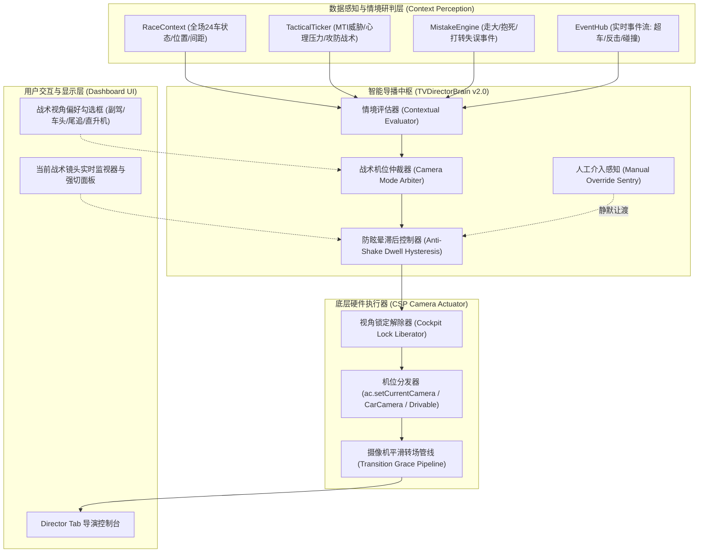

# 智能导播系统增强方案：情境化战术与沉浸式拟人机位驱动引擎
## Contextual Tactics & Immersive Anthropomorphic Camera Engine

> **版本**：v2.0-Draft  
> **状态**：方案制定中（待用户审阅）  
> **归档位置**：`docs/features/feature_design_smart_tv_director_immersive_cinematics.md`  
> **系统定位**：Assetto Corsa CSP Lua 拟人化实时转播大脑，将单一赛道/车载镜头演进为深度契合车手心理、攻防战术与赛况焦点的电影级多维度自适应导播体系。

---

## 1. 核心设计理念与背景

在原有的导播系统（v1.0）中，系统主要通过赛道电视摄影机（`Track TV`）与标准车载机位（`Car T-Cam`）在全场最高热度战局间进行宏观轮换。  
然而，真正的顶级赛车转播（如 F1、WEC、Super GT 官方转播）以及硬核拟人化驾驶体验，其灵魂在于**将镜头语言与车手的心理状态、战术意图、攻守动态深度绑定**：
1. **心理高压（Psychological Strain）**：当车手后视镜被对手塞满、压力值（Stress）飙升接近极限时，镜头切入**副驾/座舱右后方肩部视角**，观众能清晰看到车手疯狂反打、剧烈对抗方向盘回馈力、以及座舱内的震颤与高 G 值压迫感。
2. **猎手突袭（Hunter's Pounce / Attack）**：当后车发起进攻冲刺切入内线时，镜头切入**进攻者的贴地第一视角（车鼻/前保险杠贴地机位）**，带来极致的速度感、气流吸附感以及切向弯心刹车点的视觉张力。
3. **生死封堵（Defensive Coverage / Rear Mirror）**：当前车利用极限走线封堵内线、摆脱尾流时，镜头切入**防守者的尾追后视视角（Rear Chase / Reverse Cam）**，将防守车的尾翼与后方步步紧逼、大灯闪烁的对手同时同框呈现，营造窒息般的对决压迫感。
4. **两强并排争弯（Side-by-Side Duel）**：两车并排入弯时，自动调用**直升机空中鸟瞰机位（Helicopter Aerial）**，全景展现双方刹车点比拼与走线博弈。

---

## 2. 战术情境与拟人化镜头映射矩阵（Tactical Matrix）

系统建立 **7 大核心战术情境** 与 **CSP 摄像机硬件管线** 的精准映射：

| 战术情境代码 | 触发战术与物理条件 | 目标车辆（Focus Car） | 推荐摄像机模式 (CSP Camera Mode) | 镜头语言与视听效果 | 推荐驻留时长 |
| :--- | :--- | :--- | :--- | :--- | :--- |
| **`STRAIN_COCKPIT`** (心理高压副驾) | 车手 Stress > 6.5 或 MTI > 1.6，且被后车近距离压迫（Gap < 1.2s） | 受压迫的防守方车手 | `ac.CameraMode.Car` (子机位: Passenger/Cockpit) 或 `ac.CameraMode.Drivable` (`Dash`/`Cockpit`) | **副驾/肩部特写**：展现车手方向盘剧烈微调、高 G 颠簸与舱内紧绷气氛。 | 4.0 ~ 7.0s |
| **`ATTACK_NOSE`** (进攻方车鼻突袭) | 状态为 `POUNCE_PASS`、`DIVEBOMB`、`ATTACKING`，且相对前车速度更优 | 发起进攻的突袭车手 | `ac.CameraMode.Drivable` (`Bumper` / `Bonnet`) 或 `Car` (Nose Wing) | **车头贴地俯冲**：近距离撕咬前车尾流，真实呈现入弯拼晚刹车的速度震撼。 | 4.0 ~ 8.0s |
| **`DEFEND_REAR`** (防守方尾追同框) | 状态为 `DEFENSIVE_COVER`、`WEAVING_DEFENSE`、`LIFT_AND_COAST`，后车紧贴 | 领跑封堵的防守方车手 | `ac.CameraMode.Car` (Rear Wing/Reverse Cam) 或后向追踪视角 | **后视双车同框**：防守车尾翼 + 进攻车车头同框，重现后视镜视角下的窒息博弈。 | 4.0 ~ 7.5s |
| **`SIDE_HELICOPTER`** (双车并排俯瞰) | 两车间距横向并排（Lateral Dist < 2.5m, Long Dist < 3.5m），共同入弯 | 弯道内线争夺者 | `ac.CameraMode.Helicopter` 或 `Track` (高机位摄影组) | **空中大视野追踪**：鸟瞰两车并排进弯、出弯交叉剪刀线（Switchback）全过程。 | 5.0 ~ 9.0s |
| **`MISTAKE_ACTION`** (失误与打转救车) | 触发 `MISTAKE`、`SPIN`、抱死推头（Lockup）或出弯大甩尾 | 发生失误的受损车辆 | `ac.CameraMode.Track` (弯心路肩摄影组) | **弯心慢镜追踪**：赛道边缘捕捉赛车滑出赛道、胎烟弥漫与极限反打救车。 | 5.0 ~ 7.0s (P0插播) |
| **`PIT_UNDERCUT`** (进出站窗口对决) | 目标车辆处于进站作业完成、出站交汇线（Pit Exit Blend Line）时 | 进站出站车辆 vs 赛道冲线车 | `ac.CameraMode.Track` (大直道/维修区出口组) | **进站翻越对决**：捕捉刚出站冷胎赛车与大直道全速呼啸而过的对手毫厘之差。 | 6.0 ~ 9.0s |
| **`WORLD_CRUISE`** (巡航与世界广播) | 常规领跑巡航、大直道尾流蓄力、单车独走 | 当前巡航高分焦点 | `ac.CameraMode.Track` (F1 World Feed) | **电视广播长焦摇臂**：经典电视转播构图，展现赛车空气动力学与赛道全景。 | 7.0 ~ 12.0s |

---

## 3. 系统技术架构与数据流图

---

## 4. CSP 原生机位落地技术方案

### 4.1 视角层级与 API 分派机制
Assetto Corsa CSP 提供了三种维度的摄像机调用机制，系统采用**分级适配与回退机制**：
1. **`ac.CameraMode.Car`（F6 车载子摄像机组）**：
   - 每辆赛车的 `data/car.ini` 与 `cameras.ini` 内置了多个机位（如 T-Cam、Helmet Cam、Cockpit Right Shoulder、Rear Wing Cam 等）。
   - CSP 提供 `ac.accessCarCamera(index)` 与 `ac.setCurrentCarCamera(index)`，系统在初始化时自动扫描目标赛车支持的机位类型；若赛车存在座舱或后向机位，精准调度对应子索引。
2. **`ac.CameraMode.Drivable`（游戏驱动视角）**：
   - `ac.DrivableCamera.Bumper`（前保险杠）：极致贴地第一视角，用于突袭进攻；
   - `ac.DrivableCamera.Bonnet`（引擎盖视角）：极佳的攻防前视视野；
   - `ac.DrivableCamera.Dash`（仪表盘视角）：座舱沉浸视角；
   - `ac.DrivableCamera.Chase`（尾随跟车）：经典第三人称追尾视角。
3. **`ac.CameraMode.Track`（赛道摄影组）**与 **`ac.CameraMode.Helicopter`（直升机机位）**：
   - 调用 `ac.setCurrentTrackCamera(groupIndex)` 实现赛道不同弯角机位组切换。

### 4.2 防晕眩与镜头节奏控制（Dwell & Pacing Engine）
为了彻底避免由于战术状态微小抖动导致的“镜头抽搐或眩晕”：
- **最短驻留保护（Min Dwell Time）**：常规战术镜头强制保持至少 4.0~5.0 秒，严禁秒切；
- **最高优先级打断（P0 Preemption）**：仅在发生严重打转（`SPIN`）、重大撞车（`INCIDENT`）时，立即抢断切入弯心路肩特写；
- **同机位防单调轮换（Angle Rotation）**：若两车持续缠斗超过最长驻留时间（`Max Dwell`，如 9 秒），系统不直接跳走，而是在“车头视角”与“直升机视角”之间进行无缝镜头切换，保持连贯性。

---

## 5. UI 交互与用户可配置性（Pit Wall Director Console）

在主界面新增/增强以下交互控件：
1. **战术视角自适应开关（Tactical Cam Preferences）**：
   - `[✔] 启用心理高压副驾视角 (Stress Cockpit)`
   - `[✔] 启用进攻方贴地车鼻视角 (Attacker Nose Cam)`
   - `[✔] 启用防守方后视双车同框 (Defender Rear Cam)`
   - `[✔] 启用弯道并排直升机鸟瞰 (Side-by-Side Helicopter)`
2. **导播风格预设（Broadcast Style Presets）**：
   - **`F1 TV 官方转播风格 (World Feed)`**：以赛道长焦镜头为主（占 70%），关键攻防切入车头/后视；
   - **`全拟人沉浸电影风格 (Cinematic Action)`**：战术车载机位占 60%，副驾与车鼻频繁交替，极具临场感；
   - **`硬核战术分析风格 (Tactical Pit Wall)`**：直升机鸟瞰与关键弯角机位为主，呈现走线博弈。
3. **单车专属聚光灯（Star Car Spotlight）**：
   - 支持指定关注某一特定车手（如关注玩家车或特定明星 AI），导播在有攻防时优先以该车视角运镜。

---

## 6. 四阶段实施规划与验收标准

### 阶段一：CSP 多级机位抽象层与赛车机位探测器开发
- 实现 `CameraSubsystem`：封装 `ac.setCurrentCamera`、`ac.setCurrentCarCamera`、`ac.setCurrentDrivableCamera`；
- 构建零内存分配的机位缓存与安全检测，保障在任何车型缺少特定机位时自动优雅回退至 `Track` 或 `Bumper`。

### 阶段二：战术情境分析器与机位仲裁状态机（TVDirectorEngine 升级）
- 接入 `MTI`（后视镜威胁指数）、`stress`（心理压力）、`tacticalState`（战术意图）及两车空间相对向量；
- 实现 `STRAIN_COCKPIT`、`ATTACK_NOSE`、`DEFEND_REAR` 等情境打分与仲裁逻辑。

### 阶段三：DashboardUI 交互工作台与可配置偏好集成
- 在 Tab 6 渲染战术视角选项矩阵与实时机位监视器；
- 开放各情境的镜头驻留节奏调节与偏好记忆持久化（`ac.storage`）。

### 阶段四：全量测试套件扩充与真实赛道验证
- 编写测试用例验证各战术情境下的机位仲裁正确性、平滑转场及异常回退；
- 保证 60Hz 物理热循环零内存分配、无递归调用。

---

> [!IMPORTANT]
> **请审阅以上方案**：  
> 若您对战术机位类型的扩展、默认镜头节奏、或 UI 交互逻辑有新的构想或调整建议，请随时指出；经您审阅确认通过后，我们将正式开始分阶段代码实现与测试接入！
