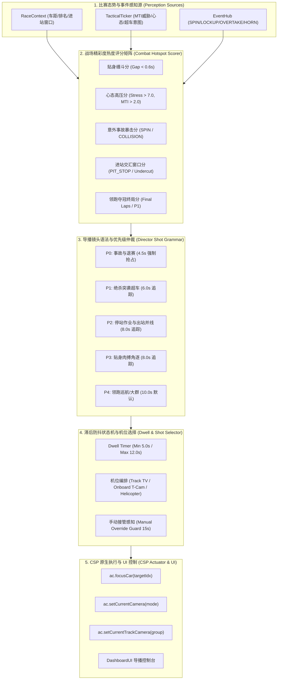
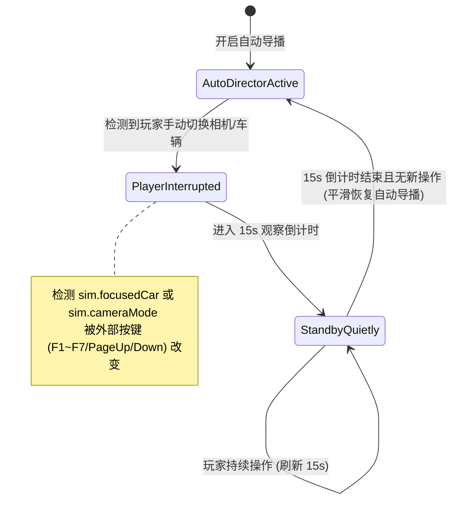

# 增强功能技术方案书：智能实时导播系统 (AI TV Director & Cinematic Broadcast Engine)

> **系统版本定位**：v1.9.0-Broadcast  
> **文档密级与性质**：全场赛况感知与电影级转播镜头自主运镜增强方案（待审阅决策）  
> **设计基准**：严格遵循 `AGENTS.md` 规范、零运行时堆内存分配、CSP Lua C-Struct FFI 安全防护与单主入口权威架构。

---

## 1. 现状痛点与系统愿景 (Problem Statement & Vision)

### 1.1 现有系统痛点分析
在当前 Assetto Corsa 与 CSP 生态中，尽管已经具备了顶级的拟人化 AI 车手大脑、车队动态策略与后视镜心理博弈，但在**观赛体验与战况呈现（Spectating & Broadcasting）**方面，依然存在以下明显瓶颈：
1. **精彩攻防频频漏拍（Blind Spot）**：玩家或解说观战 AI 锦标赛时，默认镜头往往固定在头车或玩家自身。当后方 P3 与 P4 正在发卡弯上演极限制动晚刹车超车（Divebomb），或者中游多车发生连环擦碰打转时，镜头还在拍摄领跑车辆巡航，错失全部核心戏剧张力。
2. **镜头切换缺乏语法规则（Erratic & Jittery Cuts）**：原生 AC 的 F1/F2/F3 镜头切换纯靠手动，如果简单用脚本按距离无脑切镜，会导致镜头在一两秒内来回闪烁、频繁换车，引起严重的视觉眩晕与观赛割裂感。
3. **数据感知与镜头语言脱节（Data-Camera Disconnect）**：系统内部已经掌握了极其丰富的毫秒级战术数据（如 DRS 吸附距离、后视镜威胁指数 MTI、心流/崩盘心态徽章、进站 Undercut 窗口、失误抱死走大），但这些数据未能转化为类似 F1 官方电视导播（FOM TV World Feed）的镜头叙事语言。

### 1.2 核心愿景与技术目标
- **全场战斗热点雷达（Combat Hotspot Radar）**：利用 `RaceContext` 和 `EventHub`，毫秒级评分全场 24 辆赛车的精彩度指数，自动捕捉“最具故事性与对抗冲突”的焦点区域。
- **电影级转播语法编排（Cinematic Shot Choreography）**：复刻 F1/WEC 官方电视转播镜头语言（发车鸟瞰 $\to$ 贴身猎杀车载 T-Cam $\to$ 弯道外侧低角度电视机位 $\to$ 事故特写 $\to$ 进站交汇卡位）。
- **滞后防抖与优先级抢占（Dwell Hysteresis & Priority Preemption）**：建立严密的镜头停留防抖状态机（最小停留 5s，最大停留 12s），确保转播节奏沉稳大气；同时支持突发重大事故（如打转甩尾、绝杀超车）毫秒级优先级熔断抢镜。
- **人类干预智能让渡机制（Manual Override Hysteresis）**：智能感知玩家的手动切镜意图，一旦玩家主动接管镜头，导播系统进入静默礼让模式，绝不与用户“抢鼠标/抢按键”。

---

## 2. 系统核心架构与数据流图 (Core Architecture)



---

## 3. 数学模型与运镜算法 (Mathematical Models & Algorithms)

### 3.1 战场精彩度热度指数（Combat Hotspot Index, CHI）
在 10Hz 导播仲裁步中，针对全场所有对决组与独立事件，计算热度总分 $H(i)$：

$$H(i) = S_{\text{gap}}(d) \times W_{\text{pos}} \times W_{\text{psych}} \times W_{\text{stakes}} + B_{\text{event}}$$

其中各项参数定义如下：
1. **贴身缠斗距离分 $S_{\text{gap}}(d)$**（有效缠斗区间 $0 < d \le 1.5\text{s}$ 或 $0 < d \le 35\text{m}$）：
   $$S_{\text{gap}}(d) = \begin{cases} 
   10.0 \times \left(1.0 - \dfrac{d}{1.5}\right)^2 & (0 < d \le 1.5\text{s}) \\
   0.0 & (d > 1.5\text{s})
   \end{cases}$$
2. **比赛排位权重 $W_{\text{pos}}$**：
   - 领奖台争夺（P1 ~ P3）：$W_{\text{pos}} = 1.50$
   - 积分区交锋（P4 ~ P10）：$W_{\text{pos}} = 1.20$
   - 后排争夺（P11+）：$W_{\text{pos}} = 0.85$
3. **心理高压爆发系数 $W_{\text{psych}}$**：
   - 当前车 $\text{Stress} > 7.0$ 或 $\text{MTI} > 2.0$（预示后车施压即将迫使前车失误）：
     $$W_{\text{psych}} = 1.0 + 0.35 \times \frac{\text{Stress}}{10.0}$$
   - 否则 $W_{\text{psych}} = 1.00$。
4. **终局与关键局势加成 $W_{\text{stakes}}$**：
   - 比赛最后 3 圈（Climax Laps）：$W_{\text{stakes}} = 1.35$；
   - 进站窗口关键圈（In-Lap / Out-Lap）：$W_{\text{stakes}} = 1.25$；
   - 常规巡航：$W_{\text{stakes}} = 1.00$。
5. **突发动态事件瞬时爆发分 $B_{\text{event}}$**：
   - `SPIN` / `OFFTRACK`（打转冲出赛道）：$+50.0$（直接触发最高优先级抢镜）
   - `POUNCE_PASS`（绝杀内线突袭）：$+35.0$
   - `LOCKUP` / `MISTAKE`（前轮重刹抱死拉烟）：$+25.0$
   - `PIT_STOP`（停站换胎作业）：$+20.0$
   - `HORN` / `FLASH`（大灯狂闪鸣笛抗议）：$+15.0$

---

### 3.2 导播五级镜头优先级与抢占语法（Priority & Preemption Hierarchy）

| 优先级 | 事件类别 | 标称停留时长 | 镜头机位偏好 | 抢占规则 |
| :---: | :--- | :---: | :--- | :--- |
| **P0 (EMERGENCY)** | 严重打转 (SPIN)、多车碰撞 (COLLISION)、缓冲区救车 | 4.5s ~ 5.5s | `Track` (经典 TV 慢放/全景) | 瞬时熔断任何正在播放的镜头，立即将焦点切换给事故车。 |
| **P1 (ACTION)** | 绝杀突袭 (POUNCE_PASS)、轮对轮超车 (OVERTAKE) | 6.0s ~ 7.0s | 后车 `Car` (T-Cam) 2s $\to$ `Track` 弯外机位 4s | 允许打断 P2/P3/P4；若处于 P0 期间则等待。 |
| **P2 (TACTICS)** | 停站换胎 (PIT_STOP)、进出站卡位 (Undercut Exit) | 7.0s ~ 8.0s | `Track` (维修区机位) / 前车特写 | 允许打断 P3/P4。 |
| **P3 (BATTLE)** | 贴身缠斗 (Gap < 0.6s)、后视镜暴闪施压 | 8.0s ~ 10.0s | `Track` 赛道多机位组巡回 | 必须满足最小停留 5.0s 防抖后方可平滑切镜。 |
| **P4 (ATMOSPHERE)** | 起步发车大群、领先巡航、方格旗冲线胜利 | 10.0s ~ 12.0s | `Helicopter` (直升机鸟瞰) / 主看台 `Track` | 基础兜底机位，无更高热点时自动轮转。 |

---

### 3.3 镜头防抖动滞后控制逻辑（Dwell-Time Hysteresis State Machine）

为彻底消除镜头在短时间内反复切换的视觉不适，导播引擎遵循严格的时间滞后规约：
1. **最小驻留时间（Min Dwell Time = 5.0s）**：
   除非触发 **P0 紧急事故** 或 **P1 绝杀超车**，否则任何常规镜头一旦选定，必须在当前车辆和机位至少保留 5.0 秒，严禁由于微小的得分浮动而在 1~2 秒内频繁切换。
2. **最大驻留时间（Max Dwell Time = 12.0s）**：
   即便当前赛车保持绝对领跑，单个镜头的连续驻留时间不得超过 12.0 秒，超时后必须自动降权并轮转至次高分焦点或切换机位角度（如从 Track 切至 Onboard），保持转播动态新鲜感。
3. **同组攻防镜头连续性（Dual-Car Continuity）**：
   当针对某对缠斗车辆（如 Verstappen vs Norris）转播时，若需切换机位，优先在两车之间切换（例如从后车 T-Cam 切至赛道 TV，但焦点依然锁定这组缠斗），保证故事叙事的连贯性。

---

### 3.4 人类玩家手动操控智能让渡机制（Manual Override Hysteresis）



1. **变动捕获**：每帧比对 `sim.focusedCar` 与 `sim.cameraMode`。若并非由导播引擎自身下发指令所引发的视角改变，立即判定为“人类玩家主动接管”。
2. **静默保护期（Quiet Window = 15.0s）**：导播引擎立即冻结所有自动切镜逻辑，计时器重置为 15 秒。
3. **无缝恢复**：只有在 15 秒内未检测到任何人工切镜操作后，系统才在下一个高热点事件产生时，自然地重新接手导播，做到“绝不夺权、人走我管”。

---

## 4. 拟真机位编排与 CSP API 映射 (Cinematic Camera Choreography)

| 比赛场景 | 推荐镜头机位 | CSP API 调度链 | 视觉转播意图 |
| :--- | :--- | :--- | :--- |
| **发车红灯熄灭至 T1** | 直升机鸟瞰 / 主直道大景 | `ac.setCurrentCamera(ac.CameraMode.Helicopter)`<br>`ac.focusCar(0)` | 俯瞰全场 24 车群起步冲刺、第一弯卡位与浓烈烟尘。 |
| **直道抽头尾流攻防** | 追击后车 T-Cam (车载) | `ac.focusCar(chaserIdx)`<br>`ac.setCurrentCamera(ac.CameraMode.Car)`<br>`ac.setCurrentCarCamera(0)` | 第一视角逼真再现大灯暴闪、后视镜狂震与极速接近。 |
| **弯心并线晚刹拼搏** | 赛道弯角 TV 机位组 | `ac.focusCar(leadIdx)`<br>`ac.setCurrentCamera(ac.CameraMode.Track)`<br>`ac.setCurrentTrackCamera(group)` | 展现两车轮对轮攻防、刹车点迟疑与切入弯心走线。 |
| **受迫失误打转甩尾** | 事故全景追踪 | `ac.focusCar(spinCarIdx)`<br>`ac.setCurrentCamera(ac.CameraMode.Track)` | 慢放式观察轮胎抱死白烟、车身横移滑向砂石区与后车避让。 |
| **进站换胎争夺战** | 维修区工位全景 | `ac.focusCar(pitCarIdx)`<br>`ac.setCurrentCamera(ac.CameraMode.Track)` | 技师快速换胎作业，并捕捉出站口并线并排的拖拽加速。 |
| **方格旗冲线致敬** | 领跑头车主直道机位 | `ac.focusCar(winnerIdx)`<br>`ac.setCurrentCamera(ac.CameraMode.Track)` | 领奖台冠亚军冲线，看台欢呼与胜利巡游。 |

---

## 5. UI 控制台与交互设计 (UI & Broadcast Dashboard)

在 [`lib/ui/DashboardUI.lua`](file:///D:/games/Steam/steamapps/common/assettocorsa/apps/lua/Ultimate-AI-Grand-Prix-Pro/lib/ui/DashboardUI.lua) 中新增第 5 个独立面板或在主视窗集成专属工具栏：

### 5.1 导播控制台关键控件
- **总控开关 (Master Switch)**：`[开启智能导播 (Auto TV Director)]`（勾选后自主运镜）。
- **导播风格预设 (Broadcast Flavor Profiles)**：
  1. `[官方转播风格 (World Feed - Balanced)]`：攻防、领跑、意外与进站均衡剪辑（默认推荐）。
  2. `[全场激战风格 (Action / Battle Focus)]`：仅锁定全场间距 $<0.8\text{s}$ 的拼抢缠斗，无激战才看前排。
  3. `[电影车载风格 (Onboard Cinematic)]`：优先采用车载 T-Cam 视角体验极速对决。
  4. `[明星车手专享 (Star Driver Focus)]`：专属跟踪玩家自身或指定的明星 AI（如 Verstappen、Hamilton）。
- **实时导播信息看板 (Live Director Monitor)**：
  - 当前聚焦：`#01 Max Verstappen (P1) | 机位: Track TV (Set 2)`
  - 当前镜头保持倒计时：`保持: 4.8s / 10.0s | 优先级: P3_BATTLE`
  - 全场热度榜 Top 3 实时预览列表（可点击一键直切机位）。
  - 人工干预状态提示：`[玩家已接管 (倒计时 12.4s 后恢复导播)]`。

---

## 6. 模块设计与影响范围分析 (Blast Radius & Architecture)

```
apps/lua/Ultimate-AI-Grand-Prix-Pro/
├── Ultimate-AI-Grand-Prix-Pro.lua        # 主循环接入 TVDirectorEngine.step(dt)
├── lib/
│   ├── broadcast/
│   │   └── TVDirectorEngine.lua          # [新增] 核心导播大脑 (热度评分/机位语法/防抖状态机)
│   ├── core/
│   │   └── EventHub.lua                  # [适配] 广播导播事件并提供实时热点查询
│   └── ui/
│       └── DashboardUI.lua               # [增强] 渲染导播控制台与实时监控看板
└── tests/
    └── test_grand_prix_pro.lua           # [新增] Test 59 (热度评分测试), Test 60 (机位滞后状态机)
```

### 严格合规准则
1. **零运行时内存分配**：导播引擎内部所有热点评分数组全部预分配（Fixed 24 槽位数组），计算采用纯标量展开，严禁在帧循环中产生 GC 压力。
2. **CSP API 严格保护**：所有 `ac.focusCar`、`ac.setCurrentCamera` 等调用统一经过防御包装，防止传入无效索引。
3. **与车手策略严格解耦**：导播引擎仅作为只读观察者消费 `RaceContext` 与 `EventHub`，绝不反向改写车手的物理与战术决策。

---

## 7. 实施计划与分阶段验证方案 (Implementation & Milestones)

### Phase 1：导播引擎骨架与 CSP 硬件接口封装
- **任务目标**：建立 `lib/broadcast/TVDirectorEngine.lua`，抽象 CSP 相机控制接口，实现无 CSP 模拟器环境下的 Mock 降级测试能力。
- **验证手段**：单元测试确保各枚举安全、方法调用幂等。

### Phase 2：五级战场热度评分模型与优先级抢占状态机
- **任务目标**：编码落地 $H(i)$ 热度评分公式与 P0~P4 优先级仲裁器；实现 Min 5.0s / Max 12.0s 滞后防抖状态机。
- **验证手段**：编写 **Test 59**，输入多种间距与突发失误事件，验证 P0 事故与 P1 超车能正确在规定时限内抢占镜头并按时释放。

### Phase 3：电影级机位编排与玩家手动让渡机制
- **任务目标**：落地发车鸟瞰、追击车载 T-Cam、弯道 TV 机位切换算法；实现玩家按键干预检测与 15s 智能让渡静默保护。
- **验证手段**：编写 **Test 60**，模拟外部镜头更改事件，验证系统立即进入静默观察模式并在无操作后恢复。

### Phase 4：UI 导播控制台集成与全量门禁交付
- **任务目标**：在 `DashboardUI.lua` 中渲染导播总控、风格预设切换与实时看板；双运行时通过回归测试与 `review_gate` 门禁。
- **交付目标**：全量 60 项集成测试 100% 通过，形成完整版本交付物。

---

## 8. 决策与确认要点 (Decisions for User Review)

请您审阅本技术方案并确认以下关键参数设定：
1. **镜头驻留节奏**：设计为最小停留 5.0s、最大停留 12.0s（突发事故除外），该节奏是否符合您的观赛视觉舒适度？
2. **玩家接管静默时长**：当检测到玩家主动切镜时，系统静默观察 15.0 秒后恢复自动导播，该静默时长是否合理？
3. **确认推进**：如您审阅本技术方案书无异议，请给出确认指令，我们将严格依照规划展开分阶段实施！
